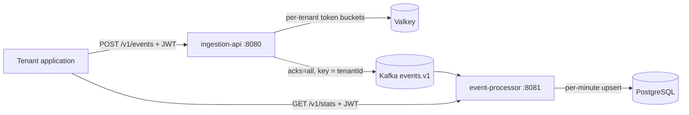

# High-throughput multi-tenant event ingestion platform

Tenants send batches of usage/analytics events over HTTP. The platform durably accepts them into Kafka, aggregates them
per tenant, event type and minute in PostgreSQL, and serves the aggregates back. It is built in stages; each stage
states its guarantees, tests them (including the failure cases), and backs performance claims with recorded runs.



**Stack:** Java 25, Spring Boot 4.1.2, Apache Kafka 4.3 (KRaft), PostgreSQL 17, Spring Security (JWT resource
server), Bucket4j + Valkey 9, Micrometer + Prometheus, Testcontainers, k6. Why each technology was chosen or excluded:
[technology selection](docs/architecture/technology-selection.md).

## Status

| Stage | Content                                                                     | State                      |
| ----- | --------------------------------------------------------------------------- | -------------------------- |
| 1     | End-to-end skeleton, observability foundation, baseline                     | **Accepted** (provisional) |
| 2     | Authentication, distributed rate limiting, admission control                | **Accepted** (provisional) |
| 3     | Processing correctness: deduplication, dead-letter topic                    | **Accepted** (provisional) |
| 4     | Resilience: overload, PostgreSQL outage, processor crash; Grafana dashboard | **Accepted** (provisional) |
| 5     | Focused performance analysis, final local validation                        | **Accepted**               |
| 6     | Local interactive demonstration GUI                                         | Done                       |

Everything runs locally with Docker Compose; this repository contains no cloud deployment code. Stages were accepted on
local evidence. GitHub Actions runs `./mvnw verify` (unit and integration tests) on every push and pull request.

## Quick start

Requires JDK 25, Docker, and `curl`, `jq`, `uuidgen` for the smoke test. Run everything from the repository root: the
services read the token-verification key from `.local/jwt/public.pem`.

E.g.:

```sh
export JAVA_HOME=$(/usr/libexec/java_home -v 25) PATH="$("/usr/libexec/java_home" -v 25)/bin:$PATH"
```

```sh
./mvnw verify                                       # build + all tests (integration tests use Docker)
java scripts/DevJwt.java keys                       # once: local signing key pair in .local/jwt/ (not committed)
docker compose -f infra/local/compose.yaml up -d    # Kafka, PostgreSQL, Valkey, Prometheus, exporters, Grafana
java -jar event-processor/target/event-processor-0.1.0-SNAPSHOT.jar   # terminal 1, port 8081
java -jar ingestion-api/target/ingestion-api-0.1.0-SNAPSHOT.jar       # terminal 2, port 8080
scripts/smoke-test.sh 200                           # 401 without token, 202 with, 429 over the burst, per-tenant stats
```

Or run the services in containers, two API replicas behind nginx on port 8080 (stop host-run services first):

```sh
docker compose -f infra/local/compose.yaml --profile apps up -d --build   # after ./mvnw package and DevJwt keys
```

Send events yourself (tenant `acme` is on the `pro` plan; others get `free`, see `rate-limit` in
[application.yaml](ingestion-api/src/main/resources/application.yaml)):

```sh
TOKEN=$(java scripts/DevJwt.java token acme)        # valid for 60 minutes
curl -i localhost:8080/v1/events -H 'Content-Type: application/json' -H "Authorization: Bearer $TOKEN" -d '{"events": [
  {"eventId": "'$(uuidgen)'", "type": "api.call", "occurredAt": "'$(date -u +%FT%TZ)'", "value": 42}]}'

curl -s -G localhost:8081/v1/stats -H "Authorization: Bearer $TOKEN" \
  --data-urlencode "from=$(date -u -v-1H +%FT%TZ)" --data-urlencode "to=$(date -u -v+1M +%FT%TZ)" | jq
```

(`date -v` is BSD/macOS syntax; on Linux use `date -u -d '-1 hour' +%FT%TZ`.)

Observe: Grafana at http://localhost:3000 (dashboard _Overload and recovery_), Prometheus at http://localhost:9090
(queries in the [observability guide](docs/guides/observability.md)), consumer lag via `kafka_consumergroup_lag`.
Load tests: [load-tests/README.md](load-tests/README.md). Fault scenarios with a per-event check against PostgreSQL:
`scripts/resilience/run.sh all` (stop host-run services first; see [scenarios](docs/resilience/scenarios.md)).

Stop: `Ctrl-C` the services, then `docker compose -f infra/local/compose.yaml --profile apps down`. Add `-v` to
delete the Kafka, PostgreSQL and Prometheus volumes.

### Interactive demo

A browser demo of ingestion under load, deduplication, tenant isolation and rate limits, with two temporary tenants
per visitor ([ADR-0015](docs/adr/0015-demo-gateway.md)). Needs Node.js 24 for the UI build, plus the stack, the
key pair and both services from the quick start above.

```sh
(cd demo-ui && npm ci && npm run build)             # static UI into demo-ui/dist/
java -jar demo-gateway/target/demo-gateway-0.1.0-SNAPSHOT.jar         # terminal 3, port 8082; from the repo root
open http://localhost:8082                          # or: scripts/demo-smoke.sh (curl + jq, about 20 s)
```

For UI development, `npm run dev` in `demo-ui/` serves the UI on http://localhost:5173 and proxies `/demo` to the
gateway. UI tests: `npm test` in `demo-ui/`. Stop: `Ctrl-C` the gateway; sessions are in memory and end with it.

## Repository layout

| Path                 | Content                                                                                                |
| -------------------- | ------------------------------------------------------------------------------------------------------ |
| `event-contract/`    | Kafka envelope record, JSON codec, topic name, validation rules shared by both services (no Spring)    |
| `ingestion-api/`     | `POST /v1/events`: JWT, validation, per-tenant limits, admission control, publish to Kafka             |
| `event-processor/`   | Kafka listener, per-minute aggregates (Flyway, `JdbcClient`), `GET /v1/stats` (JWT)                    |
| `demo-gateway/`      | Interactive demo: sessions, temporary tenants, server-side tokens and load, serves `demo-ui`           |
| `demo-ui/`           | Demo UI: React + Vite, no UI or chart libraries; Vitest + Testing Library                              |
| `infra/local/`       | Docker Compose stack (profile `apps`: services in containers behind nginx), Prometheus, Grafana, nginx |
| `scripts/`           | `DevJwt.java`; `smoke-test.sh`; `demo-smoke.sh`; `kafka-reset.sh`; `resilience/` (fault scenarios)     |
| `load-tests/`        | k6 scripts (`ingest.js`, `resilience.js`) and a runner that also collects server-side metrics          |
| `docs/architecture/` | Technology selection, delivery guarantees, C4 model (`workspace.dsl`)                                  |
| `docs/adr/`          | Architecture decision records 0001–0015                                                                |
| `docs/guides/`       | How Kafka, PostgreSQL/Flyway/HikariCP, observability, testing and Spring Boot 4 are used here          |
| `docs/performance/`  | Recorded load-test results                                                                             |
| `docs/resilience/`   | Fault scenarios: expected behaviour, checks, observed results                                          |

## Reading order

1. [Delivery guarantees](docs/architecture/delivery-guarantees.md): what a 202 means, and what happens on partial
   failure.
2. [ADRs](docs/adr/): one page each. Then [technology selection](docs/architecture/technology-selection.md) for the
   smaller choices, the excluded technologies and the open questions.
3. Code, along the path of an event:
   [`EventsController`](ingestion-api/src/main/java/io/highthroughput/ingest/web/EventsController.java) →
   [`BatchValidator`](ingestion-api/src/main/java/io/highthroughput/ingest/web/BatchValidator.java) →
   [`EventPublisher`](ingestion-api/src/main/java/io/highthroughput/ingest/publish/EventPublisher.java) →
   [`EventEnvelopeCodec`](event-contract/src/main/java/io/highthroughput/contract/EventEnvelopeCodec.java) →
   [`EventAggregationListener`](event-processor/src/main/java/io/highthroughput/processor/aggregation/EventAggregationListener.java) →
   [`EventStatsRepository`](event-processor/src/main/java/io/highthroughput/processor/aggregation/EventStatsRepository.java) →
   [`StatsController`](event-processor/src/main/java/io/highthroughput/processor/stats/StatsController.java).
   Then both `application.yaml` files: every non-default setting has its reason next to it.
4. Tests that demonstrate failure behaviour:
   [`PartialPublishFailureIT`](ingestion-api/src/test/java/io/highthroughput/ingest/PartialPublishFailureIT.java),
   [`KafkaUnavailableIT`](ingestion-api/src/test/java/io/highthroughput/ingest/KafkaUnavailableIT.java),
   [`DuplicateDeliveryIT`](event-processor/src/test/java/io/highthroughput/processor/DuplicateDeliveryIT.java),
   [`DeadLetterIT`](event-processor/src/test/java/io/highthroughput/processor/DeadLetterIT.java),
   [`SharedRateLimitIT`](ingestion-api/src/test/java/io/highthroughput/ingest/SharedRateLimitIT.java) (Valkey
   outage), [`OverloadIT`](ingestion-api/src/test/java/io/highthroughput/ingest/OverloadIT.java).
5. [Baseline](docs/performance/00-baseline.md), the [resilience scenarios](docs/resilience/scenarios.md), then the
   [Stage 5 performance analysis](docs/performance/01-after-stage-4.md).

## Known limitations

The project is deliberately incomplete. Each item below is an open question or a stated tradeoff.

| Limitation                                                     | Consequence                                                                                                                                                                                                                                                                                                                          | Status                                        |
| -------------------------------------------------------------- | ------------------------------------------------------------------------------------------------------------------------------------------------------------------------------------------------------------------------------------------------------------------------------------------------------------------------------------ | --------------------------------------------- |
| Self-issued JWTs                                               | Keys are a local file; no revocation or key rotation. A leaked token stays valid until it expires (default 60 min) ([ADR-0013](docs/adr/0013-jwt-without-identity-provider.md)).                                                                                                                                                     | Open (identity provider)                      |
| Rate limits while Valkey is unavailable                        | Each instance limits alone, with its own in-memory buckets and `1/expected-instances` of the plan, so a tenant can exceed its rate and daily quota ([ADR-0004](docs/adr/0004-rate-limit-store-outage.md)).                                                                                                                           | Tradeoff (availability first)                 |
| Plan changes do not reach an existing bucket                   | Valkey keeps a tenant's bucket and its limits until it expires, which needs a pause across the next 00:00 UTC refill. Deleting the key `rate-limit:{tenant}` applies the new plan.                                                                                                                                                   | Accepted for now                              |
| Deduplication only within 21 days                              | A copy that arrives more than 21 days after the first was counted is counted again; a DLT redrive followed by a topic replay can exceed the window ([ADR-0005](docs/adr/0005-deduplication-retention.md)).                                                                                                                           | Tradeoff (bounded ledger)                     |
| Same `eventId`, different content                              | Treated as a duplicate: the first copy counted wins.                                                                                                                                                                                                                                                                                 | Accepted                                      |
| No redrive tool for the dead-letter topic                      | Redrive is a manual copy back to `events.v1` ([procedure](docs/architecture/delivery-guarantees.md#redrive-manual)). A crash after a DLT publish can leave two copies there; the ledger absorbs them.                                                                                                                                | Open                                          |
| Unclassified failures block a partition for ≈ 2.5 min          | 10 retries with back-off before the DLT; transient database failures block it until the database is back.                                                                                                                                                                                                                            | Tradeoff (order kept, nothing lost)           |
| One upsert transaction per event                               | Two writes per event since Stage 3 (ledger and aggregate). The processor drains about 470–500 events/s locally and sustains 400 events/s; 6 consumer threads instead of 3 gained only 5% ([Stage 5](docs/performance/01-after-stage-4.md)). The API alone accepts ≥ 10,000 into Kafka ([baseline](docs/performance/00-baseline.md)). | Optional (batched transactions)               |
| Single Kafka broker, replication factor 1                      | `acks=all` means "written by the only broker"; losing its volume loses data.                                                                                                                                                                                                                                                         | Optional future investigation                 |
| Stats endpoint inside the processor                            | Stats queries share CPU and the connection pool with consumption ([ADR-0006](docs/adr/0006-stats-endpoint-in-processor.md)); bounded by a 5 s query timeout and a 24 h range.                                                                                                                                                        | Tradeoff, revisited if measurements demand it |
| Tenant isolation rests on query predicates only                | No row-level security; a query without `tenant_id` would leak data (Q5 in [technology selection](docs/architecture/technology-selection.md#6-open-questions-and-recommendations)).                                                                                                                                                   | Open (Q5)                                     |
| Management endpoints on the application port                   | `/actuator/prometheus` is reachable wherever the API is (Q9). nginx forwards only `/v1/events`.                                                                                                                                                                                                                                      | Open                                          |
| Prometheus scrapes only host-run services                      | With the compose profile `apps`, the containerized services are not scraped.                                                                                                                                                                                                                                                         | Open                                          |
| No structured logging                                          | Correlating the logs of two API replicas is manual (Q7).                                                                                                                                                                                                                                                                             | Open (Q7)                                     |
| End-to-end latency compares two processes' clocks              | Accurate only on one host or with synchronized clocks.                                                                                                                                                                                                                                                                               | Documented caveat                             |
| Validation errors are sorted lexicographically by JSON pointer | `/events/10` sorts before `/events/2`. Capped at 50 errors.                                                                                                                                                                                                                                                                          | Accepted                                      |
| Performance numbers are single runs on one laptop              | Each configuration ran once, so run-to-run variation is unknown. Load generator, broker, database and services share one 8-thread laptop; above 1,200 events/s with the processor running the host saturates and API p99 reaches 0.5–2.8 s (p99 28–53 ms without the processor).                                                     | Optional (≥ 3 runs)                           |
| Resilience shown for three faults, single runs                 | Overload, PostgreSQL outage and processor crash each passed once on one machine ([scenarios](docs/resilience/scenarios.md#observed-results)). Kafka outage, slow PostgreSQL, Valkey outage and several processors are not tested; unresolved ambiguous publishes make a run INCONCLUSIVE.                                            | Optional future investigation                 |
| Demo sessions are in memory                                    | A gateway restart ends every session; one gateway instance only ([ADR-0015](docs/adr/0015-demo-gateway.md)).                                                                                                                                                                                                                         | Tradeoff (Valkey if needed)                   |
| Demo per-client session cap uses the TCP peer address          | Behind a load balancer every visitor shares one address until a trusted forwarded header is used.                                                                                                                                                                                                                                    | Open                                          |
| Demo overview is platform-wide                                 | The platform has no per-tenant metrics; the overview includes other visitors' traffic and is labelled so. Session figures come from `/v1/stats`.                                                                                                                                                                                     | Accepted                                      |
| Demo run after an incomplete run                               | Late events of a run that hit the drain timeout are aggregated afterwards and can raise the next same-type run's processed count (clamped to its accepted count).                                                                                                                                                                    | Accepted (shown as incomplete)                |
| Demo remaining quota is counted by the gateway                 | Tenant B's remaining quota is the plan quota minus the session's accepted events of the current UTC day; the platform does not expose the bucket. Under the Valkey fallback (ADR-0004) the real limit can differ. Refused load-run batches are not retried.                                                                          | Accepted                                      |
